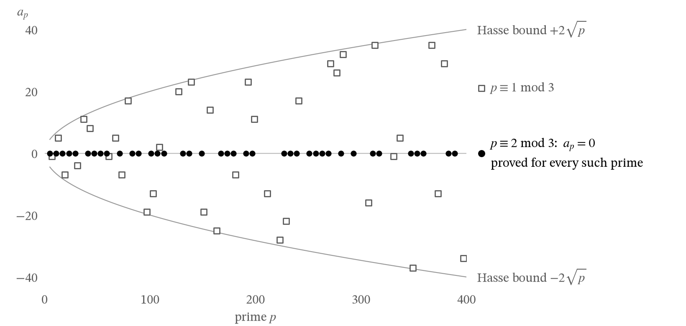

# bsd-lean

Machine-checked theorems about the L-function of an elliptic curve, proved in Lean 4 against
Mathlib's own definition.

Take the curve `y² = x³ - 432`. Count its points modulo a prime `p`, call the count `N_p`, and set
`a_p = p + 1 - N_p`. Those numbers are the coefficients of the curve's L-function, and the Birch and
Swinnerton-Dyer conjecture (BSD) says that the behaviour of that function at one point decides how
many rational points the curve has. Mathlib, the mathematics library of the Lean proof assistant,
has had a definition of this L-function since April 2026 (`WeierstrassCurve.LFunction`), and until
now no theorem about it. The definition is built from completions, minimal models and reduction
types, and nothing in Mathlib or in the public Lean code I could find showed that it produces the
numbers `p + 1 - N_p`.

This repository proves that it does, and then uses the result on a real curve.



The filled dots are a theorem here: `a_p = 0` at every prime `p ≡ 2 mod 3` other than `2`. The
chart itself is drawn by brute-force counting (`python3 scripts/ap_chart.py`). Everything here
compiles, every proof is complete, and the only axioms used are Lean's three standard ones.

It does not prove any case of BSD. It is groundwork that a statement of BSD in Lean needs before
anyone can compute with it.

## The main theorem

For a Weierstrass equation with integer coefficients and a prime `p` that does not divide its
discriminant, the `p`-th coefficient of Mathlib's L-function is `p + 1` minus the number of points
of the curve modulo `p` (the point at infinity included):

```lean
theorem WeierstrassCurve.LFunction_baseChange_apply_of_not_dvd
    (W₀ : WeierstrassCurve ℤ) (p : ℕ) [Fact p.Prime] (h : ¬ (p : ℤ) ∣ W₀.Δ) :
    (W₀.baseChange ℚ).LFunction p =
      p + 1 - Nat.card (W₀.baseChange (ZMod p)).toAffine.Point
```

File: [`BSD/LFunctionRatIntegral.lean`](BSD/LFunctionRatIntegral.lean).

## Check it yourself

```
git clone https://github.com/abhaymettu/bsd-lean && cd bsd-lean
lake exe cache get          # prebuilt Mathlib, no compiling from source
lake build
lake env lean Verify.lean
```

`lake build` must end with `Build completed successfully`. `Verify.lean` walks every declaration in
the project, collects the axioms each one depends on, and fails if it finds anything other than
`propext`, `Classical.choice` and `Quot.sound` (a `sorry` would show up there as `sorryAx`). Its last
line should read:

```
AUDIT: 137 declarations in BSD.* modules, 70 theorems, 0 with non-standard axioms
```

Pinned versions: Lean `v4.36.0`, Mathlib tag `v4.36.0`. You need `elan` and about 7 GB of disk.
[`AGENTS.md`](AGENTS.md) has the setup in full.

## What is proved

Each file has a module docstring listing its results. In the order they build on each other:

| File | What it proves |
|---|---|
| [`LocalFactor.lean`](BSD/LocalFactor.lean) | The first lemmas about Mathlib's local L-factor at a prime: the local polynomial is `1 - a T + q T²`, `1 - T`, `1 + T` or `1` according to the reduction type, the local power series is its inverse, and the coefficients satisfy the recursion `c(n+2) = a c(n+1) - q c(n)`. |
| [`LFunctionBasic.lean`](BSD/LFunctionBasic.lean) | `W.LFunction` is multiplicative over any number field, `W.LFunction 1 = 1`, and over `ℚ` its value at `p^k` is the `k`-th coefficient of the local power series at `p`. |
| [`GoodReduction.lean`](BSD/GoodReduction.lean) | A criterion Mathlib lacked: an integral Weierstrass equation whose discriminant is a unit is minimal and has good reduction, and so does the minimal model Mathlib chooses. With an if-and-only-if version. |
| [`GoodReductionTrace.lean`](BSD/GoodReductionTrace.lean) | The number of points does not change under a change of variables (Mathlib had the translation case only), so the trace of Frobenius can be read off any integral model with unit discriminant. |
| [`LFunctionRat.lean`](BSD/LFunctionRat.lean) | The Euler product over `ℚ` in textbook form. At a prime of good reduction `a_p = p + 1 - N_p` and `a_{p^(n+2)} = a_p a_{p^(n+1)} - p a_{p^n}`. At bad primes `a_{p^k}` is `1` (split multiplicative), `(-1)^k` (non-split) or `0` (additive, `k ≥ 1`). |
| [`LFunctionRatIntegral.lean`](BSD/LFunctionRatIntegral.lean) | The main theorem above, and the same recursion, for any integer Weierstrass equation and any prime not dividing its discriminant. |
| [`FermatCubic.lean`](BSD/FermatCubic.lean) | The other side of BSD for one curve. The rational points of `y² = x³ - 432` are `(12, 36)`, `(12, -36)` and the point at infinity, the group of rational points is `ℤ/3`, and its rank is `0`. The proof goes through Fermat's Last Theorem for exponent 3, which Mathlib has. |
| [`SupersingularPrimes.lean`](BSD/SupersingularPrimes.lean) | The main theorem put to use. For `y² = x³ + b` and a prime `p ≡ 2 mod 3` (`p ≠ 2`, `p ∤ b`) the curve has exactly `p + 1` points modulo `p`, so `a_p = 0` and `a_{p²} = -p`. The same holds for `y² = x³ + a x` at primes `p ≡ 3 mod 4` not dividing `a`. For the curve `y² = x³ - 432` this gives infinitely many vanishing coefficients, and `a_7 = -1` and `a_13 = 5` by counting points. |

The two statements about `y² = x³ - 432`, as Lean reads them:

```lean
theorem FermatCubic.nonempty_point_addEquiv_zmod : Nonempty (E.Point ≃+ ZMod 3)

theorem FermatCubic.infinite_setOf_prime_and_LFunction_eq_zero :
    {p : ℕ | p.Prime ∧ E.LFunction p = 0}.Infinite
```

At `p = 11` the theorem for primes congruent to 3 modulo 4 gives `a_11 = 0` for `E: y² = x³ - x`, so its Frobenius polynomial is `T² + 11`. Both roots have 11-adic valuation `1/2`. Crossley uses this to rule out a nonzero map from a genus-two Jacobian to `E` in a prime-race rank calculation. [Point counts and Newton polygons](https://github.com/leecrossley/theta-host-split-inert-race/blob/33d454fbbce252bfac9068c792f25b193f377f93/results/algebraic-heights/PROOF.md#L748) and [archived paper](https://doi.org/10.5281/zenodo.24429782).

## What is new, and what is not

I checked on 2026-11-21, against Mathlib (tag `v4.36.0` and master) and public Lean code on GitHub.

Not found anywhere else:

- The coefficients of Mathlib's `LFunction` over `ℚ`: its value at `p^k` as a coefficient of the
  local power series, `a_p = p + 1 - N_p`, the recursion at good primes, the values at bad primes,
  and the main theorem for an integer equation (`LFunctionBasic.lean` in part, `LFunctionRat.lean`,
  `LFunctionRatIntegral.lean`).
- The group of rational points of `y² = x³ - 432` (`FermatCubic.lean`).
- The point counts and vanishing coefficients for `y² = x³ + b` and `y² = x³ + a x`, and `a_7`,
  `a_13` (`SupersingularPrimes.lean`).

Already proved elsewhere: the [TauCeti](https://github.com/TauCetiProject/TauCeti) project (checked at
commit `84d74ced`) has several of the supporting lemmas, some under the same names. That covers the
multiplicativity of the L-function and its value at `1`, the local polynomial in each reduction type,
minimality of an integral model with unit discriminant, the point count under a change of variables
over a field, and good reduction away from the discriminant over a Dedekind domain. They were proved
here independently, before I knew, and TauCeti deserves the credit for them. TauCeti goes further on
other fronts too: it proves that isogenous curves have the same L-function. Its theorems about the
elliptic curve `LFunction` are multiplicativity, the value at `1` and the isogeny statement, and
none of them computes a coefficient.

Also public already, on other definitions: a formal statement of BSD
(`google-deepmind/formal-conjectures`, TauCeti), point counts by character sums and the Hasse bound,
Mordell-Weil and Selmer groups, and the rational points of a few other curves.

The searches, Lean files only on GitHub code search: `localPolynomial WeierstrassCurve` (copies of
Mathlib's file only), `localEulerFactor` (Mathlib, copies of it, and unrelated L-functions),
`HasGoodReduction LFunction`, `"x ^ 3 - 432"` and `fermatLastTheoremThree WeierstrassCurve` (nothing),
`HasGoodReduction` (this is what led to TauCeti, which was then cloned and searched for every headline
statement). Mathlib pull requests for `localPolynomial`, `localEulerFactor`, `WeierstrassCurve.LFunction`
and "Fermat cubic": only the pull requests that added the definitions, and one on Hecke L-functions.

A search like this can miss things, and the first pass here did miss TauCeti's lemmas. If you know of
earlier Lean work on these statements, please open an issue.

## What this is not

- Not a proof of BSD, or of any case of it. Nothing here is about the value or the order of vanishing
  of the L-function at `s = 1`. Mathlib does not yet have the analytic continuation that question
  needs.
- Not new mathematics. Every statement is classical and in the textbooks. What is new is that Lean
  has checked them for the definition Mathlib uses.
- Not yet part of Mathlib. [`PR-DRAFT.md`](PR-DRAFT.md) says how the files would be split into pull
  requests.

## How it was made

I started this the day after a Lean proof of the Riemann Hypothesis was posted, to learn how that
kind of work is done with AI models. The proofs here were written by Claude models. Claude also
surveyed what Mathlib was missing and proposed the statements. What I built is the loop that keeps
that work honest, in [`harness/`](harness/README.md):

1. A statement is written first, with `sorry` in place of the proof, and frozen.
2. A model attempts a proof. Lean compiles it. The errors go back to the model.
3. A gate decides. It re-states every frozen theorem after the candidate file and closes each one
   with the candidate's theorem, so a weakened statement, an added hypothesis, a changed definition, a
   `sorry` or a new axiom all fail. Every attempt is written to a ledger.

`harness/prove.py selftest` runs the gate against files built to cheat it. The harness is not tied
to elliptic curves: `harness/examples/` holds a linear algebra statement that went through it
unchanged.

## Next

The rank of `y² = x³ - 432` did not come from elliptic curve machinery. It came through Fermat's Last
Theorem for exponent 3, a result Mathlib already had in a different corner. The count for
`y² = x³ + a x` came through quadratic characters, and the infinitely many zeros through Dirichlet's
theorem on primes in progressions. Each time the route was a bridge to something already proved far
from the goal.

So the harness now has a step that looks for those bridges before a route is picked.
`harness/prove.py scan BSD/FermatCubic.lean` sends the bare statements to a model and asks which
results in distant areas of Mathlib could carry the proof. Lean then checks every name it proposes,
so an invented lemma is marked as not found. On the Fermat cubic it listed `fermatLastTheoremThree`
first; the table is in [`harness/scans/FermatCubic.md`](harness/scans/FermatCubic.md). That was an
easy case, since one of the statements is `u³ + v³ = 1`. What I have not tried is a target where the
bridge is not written into the statement.

On the mathematics: the main theorem over number fields, the coefficients of `y² = x³ - 432` at the
bad primes `2` and `3`, and a statement of BSD for this curve with both sides computed.

## Licence

Apache 2.0, the same as Mathlib. See [`LICENSE`](LICENSE).
